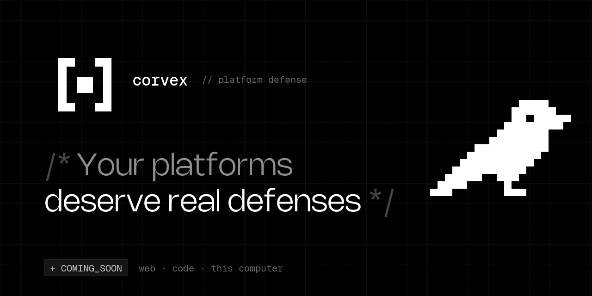

<!-- Da copiare nel repository pubblico «.github» dell'organizzazione, nel file profile/README.md -->

<p align="left"></p>

### `/*` Your platforms deserve real defenses `*/`

**Corvex** puts the dashboards, software and computer you work on to the test.
A team of 28 specialised agents hunts for security gaps, alerts you and tells you how to close them.
When it's safe to do so, it fixes them on its own, or opens a pull request for you to review.
The AI behind it is **corvexai**, a model we developed for security work. It ships with Corvex and runs locally.

**Website:** [corvexdevelops.github.io](https://corvexdevelops.github.io/) · [team](https://corvexdevelops.github.io/team.html) · [corvexai](https://corvexdevelops.github.io/corvexai.html) · [updates](https://corvexdevelops.github.io/updates.html)

​```text
$ corvex --status
web ............... headers, TLS, cookies, CORS, exposed files, injections, APIs, email, subdomains
code .............. secrets, git history, weak crypto, dangerous settings, vulnerable dependencies
this computer ..... malware in new files, system posture, exposed services, network traffic
ai ................ corvexai, our own model, local, no third-party providers
open source ....... corvex-bench, corvex-netkit, ai-security-rules
website ........... corvexdevelops.github.io
download .......... coming soon
​```

- **Runs on your machine.** Your code, files and results never leave it.
- **Fixes, not just findings.** Ready-made fixes you approve, or pull requests on a separate branch.
- **Our own AI, corvexai.** Built by us for security work, it powers CORVUS and the code audit. No cloud AI, no data sent to third parties.
- **Plain-language answers.** CORVUS, the built-in assistant, explains every issue and where to start.
- **Measured in public.** The benchmark we test Corvex with is open source, so you can check our numbers and measure any other tool the same way.
- **Windows, macOS and Linux.** Web dashboard or desktop app, in English and Italian.

### `/*` Measured in public, with a yardstick you can use too `*/`

[**corvex-bench**](https://github.com/CorvexDevelops/corvex-bench) is the benchmark we measure Corvex with: a website, a project and a network capture with 71 known flaws, each paired with a clean twin. Every finding on a clean twin counts as a false alarm.

​```text
$ python3 bench/bench.py score results/
web-vulnerable ..... 18/18 found
code-vulnerable .... 32/32 found
traffic-attacks .... 21/21 found
clean twins ........ 0 false alarms
71/71 · offline, without AI
​```

It scores the results of any tool in SARIF or JSON, and catches regressions against a saved baseline.

<sub>The targets are twins of the benchmark Corvex is tuned on: it's our reference, not an independent test.</sub>

### `/*` Open source `*/`

| Repository | What it is |
|---|---|
| [**corvex-bench**](https://github.com/CorvexDevelops/corvex-bench) | An honest benchmark for security scanners and AI code auditors: 71 known flaws, clean twins for false alarms, SARIF and JSON scoring, regression baseline. |
| [**corvex-netkit**](https://github.com/CorvexDevelops/corvex-netkit) | Network and vulnerability utilities written from public specs: read .pcap and .pcapng, generate captures with 21 common attacks, match installed versions to real CVEs, look up addresses in huge network lists. |
| [**ai-security-rules**](https://github.com/CorvexDevelops/ai-security-rules) | Security rules for AI coding agents (Claude Code, Cursor, Copilot, Windsurf, AGENTS.md): no leaked keys, no open Supabase or Firebase, no AI endpoints without limits. Ready-to-copy files plus a generator for your stack. |
| [**corvex-opensource**](https://github.com/CorvexDevelops/corvex-opensource) | The open skills and tools of corvexai in one place: how to report findings with checkable quotes of the code, how to measure a scanner honestly, and the tools above. |

All Apache License 2.0, pure Python, no dependencies, no model weights.

> Corvex is in its final polishing stage. Downloads and plans open soon.

---

<sub>🇮🇹 Corvex mette alla prova le tue piattaforme, trova le falle e le corregge, con corvexai, la nostra AI. Il banco di prova e gli strumenti sono open source. In arrivo.</sub>
