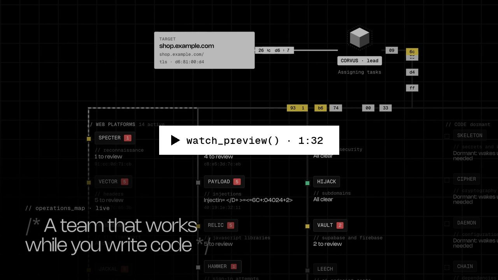

<!-- Da copiare nel repository pubblico «.github» dell'organizzazione, nel file profile/README.md -->

### `/*` Your platforms deserve real defenses `*/`

**Corvex** puts the dashboards, software and computer you work on to the test.
A team of 28 specialised agents hunts for security gaps, alerts you and tells you how to close them.
When it's safe to do so, it fixes them on its own, or opens a pull request for you to review.
The AI behind it is **corvexai**, a model we developed for security work. It ships with Corvex and runs locally.

**Website:** [corvexdevelops.github.io](https://corvexdevelops.github.io/) · [team](https://corvexdevelops.github.io/team.html) · [features](https://corvexdevelops.github.io/features.html) · [corvexai](https://corvexdevelops.github.io/corvexai.html) · [community](https://corvexdevelops.github.io/community.html) · [updates](https://corvexdevelops.github.io/updates.html)

- **Runs on your machine.** Your code, files and results never leave it.
- **Fixes, not just findings.** Ready-made fixes you approve, or pull requests on a separate branch.
- **Our own AI, corvexai.** Built by us for security work, it powers CORVUS and the code audit. No cloud AI, no data sent to third parties.
- **Plain-language answers.** CORVUS, the built-in assistant, explains every issue and where to start.
- **Measured in public.** The benchmark we test Corvex with is open source, so you can check our numbers and measure any other tool the same way.
- **Built for teams.** Team chat, a discussion on every issue, SSO, a read-only reviewer role and a tamper-evident activity log.
- **Windows and macOS.** Web dashboard or desktop app, in English and Italian.

### `/*` The team: 28 agents `*/`

Each agent has one job. CORVUS studies the target, decides who works and in which order, and writes the report. Meet them all on the [team page](https://corvexdevelops.github.io/team.html).

### `/*` corvexai: our AI model, one job: security `*/`

The Corvex team trained it in-house on an analyst's real tasks. It runs on your server and questions never leave. It powers CORVUS, the plain-language assistant, and ORACLE, the AI code audit that tries to disprove its own findings before showing them. [All the numbers](https://corvexdevelops.github.io/corvexai.html).

### `/*` Watch Corvex at work `*/`

92 seconds of the real dashboard: a target behind the sign-in, the live scan, issues with their proof, the fix, pull request checks, System, the team chat and CORVUS. [Watch it on the website](https://corvexdevelops.github.io/#anteprima) or [open the video](https://corvexdevelops.github.io/assets/corvex-preview.mp4).

### `/*` Recent news `*/`

- **Every agent sharper.** Over 50 new checks across web, code and System, false alarms fixed one by one. Our internal test bench now finds 215 issues out of 215, with zero false alarms.
- **Team chat and integrations.** Channels, direct messages and a discussion on every issue. Alerts on Slack, Microsoft Teams, Jira Cloud or a signed webhook.
- **Scans behind the sign-in.** An encrypted sign-in profile lets the agents test the private area too. Credentials never show in evidence or reports.
- **Pull request checks.** Code agents block the merge on new issues, with SARIF for GitHub Code scanning. Runs on your own machines.

All the news: [corvexdevelops.github.io/updates.html](https://corvexdevelops.github.io/updates.html)

### `/*` Measured in public, with a yardstick you can use too `*/`

[**corvex-bench**](https://github.com/CorvexDevelops/corvex-bench) is the benchmark we measure Corvex with: a website, a project and a network capture with 71 known flaws, each paired with a clean twin. Every finding on a clean twin counts as a false alarm.

It scores the results of any tool in SARIF or JSON, and catches regressions against a saved baseline.

The targets are twins of the benchmark Corvex is tuned on: it's our reference, not an independent test.

### `/*` Open source `*/`

<!-- repos:start -->
| Repository | What it is | Updated |
|---|---|---|
| [**corvex-bench**](https://github.com/CorvexDevelops/corvex-bench) | An honest benchmark for security scanners and AI code auditors: 71 known flaws, clean twins for false alarms, SARIF and JSON scoring, regression baseline. | 19 Nov 2026 |
| [**corvex-netkit**](https://github.com/CorvexDevelops/corvex-netkit) | Network and vulnerability utilities written from public specs: read .pcap and .pcapng, generate captures with 21 common attacks, match installed versions to real CVEs, look up addresses in huge network lists. | 19 Nov 2026 |
| [**ai-security-rules**](https://github.com/CorvexDevelops/ai-security-rules) | Security rules for AI coding agents (Claude Code, Cursor, Copilot, Windsurf, AGENTS.md): no leaked keys, no open Supabase or Firebase, no AI endpoints without limits. Ready-to-copy files plus a generator for your stack. | 19 Nov 2026 |
| [**corvex-opensource**](https://github.com/CorvexDevelops/corvex-opensource) | The open skills and tools of corvexai in one place: how to report findings with checkable quotes of the code, how to measure a scanner honestly, and the tools above. | 19 Nov 2026 |
<!-- repos:end -->

All Apache License 2.0, pure Python, no dependencies, no model weights.

> Corvex is in its final polishing stage. Downloads open soon.

---

🇮🇹 Corvex mette alla prova le tue piattaforme, trova le falle e le corregge, con corvexai, la nostra AI. Il banco di prova e gli strumenti sono open source. In arrivo.
